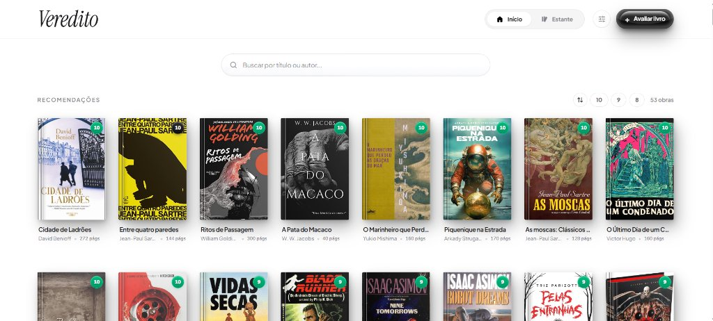

  

  Curador e avaliador pessoal de livros e HQs que separa a qualidade de escrita de uma obra do quanto ela realmente combina com o seu gosto.

---

## O Produto

Escolher um livro quase sempre esbarra no mesmo problema: sinopses de editora parecem propaganda, notas médias da Amazon ou Goodreads misturam leitores com gostos opostos, e resenhas longas costumam entregar *spoilers*.

O **Veredito** foi criado para responder de forma rápida se um livro vale o seu tempo antes de você comprá-lo ou começar a ler.

### Como funciona

- **Nota Técnica vs. Nota de Encaixe:** separa se o livro é bem escrito (*Nota Técnica*) de se ele serve para você (*Nota de Encaixe*). Um clássico pode ter técnica 9 e encaixe 4 para o seu perfil — o app avisa na lata (**Leia**, **Vale com Ressalvas** ou **Evite**), sem revelar reviravoltas da história.
- **Calibrado pelo seu repertório:** em vez de formulários genéricos de gênero favorito, o perfil usa suas referências reais (filmes, séries, personagens favoritos e o que você não suporta ler).
- **Aprende com o que você lê:** ao marcar um livro como lido (**"Já li"**) e dar sua nota, o sistema compara o que você achou com o que ele havia previsto. Se ele deu 9 e você deu 6 porque achou lento, ele passa a descontar pontos de livros parecidos nas próximas análises.
- **Atmosfera em filmes e leitura por personagens:** cada ficha mostra 3 filmes com o mesmo clima do livro para situar o tom rapidamente. E quando você não sabe o que buscar, pode escolher um personagem (*Anakin Skywalker*, *Carmy*, *Ellie*, *Thanos*) para ver 4 livros que batem com a psicologia dele.
- **Interface limpa e direta:** capas com acabamento de livro físico (e capa em couro gerada automaticamente quando o livro não tem imagem nas APIs), avaliação colando direto o link da Amazon ou uma lista de títulos, e estante organizada sozinha entre *Lidos*, *Salvos*, *Obras-Primas*, *Clássicos*, *Sci-Fi* e *Zona de Rejeição*.

---

## Por baixo do capô

Construído com **React 19**, **TypeScript**, **Vite**, **Tailwind CSS**, **Motion**, **Supabase** e **Google Gemini API**.

- **Busca pensada para edições brasileiras (`evaluator.ts` / `amazonRecognizer.ts`):** APIs abertas como a Open Library são voltadas para bibliotecas americanas antigas e falham muito com edições comerciais brasileiras, enquanto a Google Books API bloqueia chamadas sem OAuth (`429`). O app resolve isso em camadas: extrai `ASIN`/`ISBN` direto de links da Amazon (puxando a capa oficial da CDN deles), consulta a Câmara Brasileira do Livro (BrasilAPI), usa um catálogo em memória para clássicos (`0ms`) e separa o modelo leve da busca rápida do modelo de raciocínio usado na avaliação crítica.
- **Concorrência de modelos contra lentidão (`geminiRace.ts`):** para não travar a tela quando a API do Gemini oscila ou retorna erro `503`, o `raceGemini` dispara o modelo principal e, se passar do tempo limite, aciona modelos reserva em paralelo, abortando as conexões restantes via `AbortController` assim que o primeiro JSON válido chega.
- **Retroalimentação de histórico (`ratings.ts`):** as notas reais do usuário viram um bloco de calibração (`previsto → nota do leitor`) com as leituras recentes e os maiores erros de previsão da IA, ajustando o peso das próximas análises sem precisar de *fine-tuning*.
- **Zero tela de carregamento entre abas (`supabase.ts` / `BookCover.tsx`):** avaliações, notas e capas já validadas ficam em cache na memória (`O(1)`) com sincronização em segundo plano no Supabase. O componente de capa também detecta e descarta imagens `1x1` inválidas que CDNs antigas retornam como `HTTP 200`.
