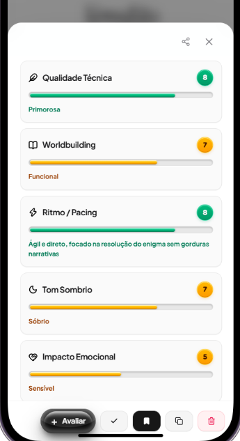

# Veredito

Um avaliador e curador pessoal de livros e HQs que separa a qualidade técnica de uma obra do quanto ela realmente combina com o seu gosto.


---

## Parte 1 — O Produto

### O problema que originou o app

Escolher o próximo livro para ler costuma dar errado por três motivos simples:

1. **Sinopses de editora são peças de marketing:** todas prometem "uma obra-prima arrebatadora", mas escondem se o ritmo é arrastado, se o tom é juvenil ou se a história se apoia em clichês.
2. **Notas médias na internet misturam públicos opostos:** um livro com nota 4,8 na Amazon ou no Goodreads pode ser excelente para quem busca um romance leve de fim de semana e insuportável para quem procura densidade moral ou ficção científica mais séria.
3. **Resenhas quase sempre entregam demais:** tentar descobrir se um livro vale o seu tempo pesquisando em vídeos ou textos longos geralmente termina em *spoilers* de reviravoltas que você não queria saber.

O **Veredito** nasceu para responder uma pergunta direta antes de você gastar dinheiro ou horas de leitura: *"Esse livro é bom de verdade e conversa com o que eu gosto, ou vou largar na página 40?"*

---

### Como ele pensa: Nota Técnica vs. Nota de Encaixe

A principal decisão do produto foi dividir a avaliação em duas notas independentes:

- **Nota Técnica (0 a 10):** avalia a obra pelo que ela é — construção de prosa, estrutura narrativa, originalidade e execução do autor.
- **Nota de Encaixe (0 a 10):** mede o quanto aquele livro bate com o perfil específico do leitor.

Um clássico consagrado pode receber **Nota Técnica 9** e **Nota de Encaixe 4** se tiver um ritmo contemplativo demais ou temas que não conversam com o usuário. Com base nisso, cada ficha traz um veredito direto (**Leia**, **Vale com Ressalvas** ou **Evite**) e uma premissa escrita sem revelar reviravoltas do meio ou do fim do livro.

---

### Entendimento do usuário e calibração que aprende com a leitura

Em vez de pedir ao leitor para marcar categorias genéricas como "Suspense" ou "Ficção", o Veredito calibra as análises a partir do repertório real da pessoa: filmes e séries que são referência para ela, arquétipos de personagens favoritos e o que ela rejeita de imediato (como prolixidade sem recompensa, romance adolescente focado em fórmula ou autoajuda disfarçada de ficção).

Quando o usuário termina um livro e registra a própria nota no botão **"Já li"** (podendo marcar impressões rápidas como *"Ritmo impecável"*, *"Me marcou"*, *"Ideia boa, ritmo lento"* ou *"Raso / besta"*), o app passa a usar esse histórico real nas próximas avaliações:

- Se o sistema previu nota **9** para um livro e você deu **6** porque achou o ritmo arrastado, ele registra essa divergência e passa a ser mais rigoroso com obras de estrutura parecida.
- O livro lido sai automaticamente da lista de desejos (*Salvos*) e vai para a prateleira de *Lidos*, mantendo a estante limpa sem trabalho manual.

---

### Descoberta visual, personagens e UI/UX

<p align="center">
  
  &nbsp;
  
  &nbsp;
  
</p>

A interface foi pensada para fugir da aparência de planilha ou painel cheio de texto e funcionar como uma estante limpa e tátil:

- **Acabamento físico nas capas:** cada capa recebe iluminação de lombada, vinco de encadernação de capa dura e sombra projetada. Quando uma edição antiga não tem imagem disponível nas bases públicas (ou retorna imagem quebrada), o componente desenha automaticamente uma capa tipográfica em couro.
- **Filmes com atmosfera equivalente:** toda ficha aponta 3 filmes que compartilham o mesmo clima ou tensão psicológica do livro, com pôsteres reais para situar o tom da obra em segundos.
- **"O que este personagem leria?":** para os momentos em que o usuário quer ler algo novo mas não tem um título em mente, o modal de avaliação sugere obras a partir da psicologia de personagens conhecidos (como *Anakin Skywalker*, *Carmy* de *The Bear*, *Ellie* de *The Last of Us* ou *Thanos*), priorizando livros que ainda não estão na sua estante.
- **Fluxos rápidos para o dia a dia:**
  - Colar o link de qualquer livro da Amazon identifica a edição na hora.
  - A aba **Colar Lista** permite jogar vários títulos de uma vez para avaliar em lote.
  - Ao lado dos filtros de nota (`10`, `9`, `8`), o botão **Selecionar** permite marcar vários livros ou avaliações de uma só vez para salvar na estante ou excluir, com opção de desfazer.

---

## Parte 2 — Engenharia e Decisões Técnicas

### Stack

- **Frontend:** React 19, TypeScript, Vite, Tailwind CSS 4, Motion (`motion/react`), Lucide Icons
- **Banco de Dados & Persistência:** Supabase (PostgreSQL) + cache local assíncrono (`localStorage` + memória)
- **IA & Dados Editoriais:** Google Gemini API, Câmara Brasileira do Livro (via BrasilAPI), Amazon Image CDN, Open Library e iTunes/Apple Media API (pôsteres de filmes)

---

### Decisões de arquitetura que valem destaque

#### 1. Busca de edições brasileiras em camadas (`src/services/evaluator.ts`)
APIs públicas de livros como a Open Library funcionam bem para edições em inglês dos anos 80, mas falham com frequência no mercado editorial brasileiro (trazem traduções erradas, livros acadêmicos homônimos ou capas inexistentes), enquanto a API pública do Google Books sofre com limites severos de cota (`HTTP 429`) sem OAuth.

Para garantir que a busca encontre a edição brasileira correta em menos de 2 segundos, a resolução segue uma cascata:
1. **Parser de links da Amazon (`amazonRecognizer.ts`):** extrai o `ASIN`/`ISBN-10` direto da URL, identifica a edição e resolve a capa em alta definição direto pela CDN da Amazon.
2. **Busca por ISBN:** consulta a base da Câmara Brasileira do Livro (BrasilAPI) em paralelo com a Open Library.
3. **Catálogo curado em memória (`0ms`):** resposta instantânea para clássicos e edições brasileiras recorrentes (Companhia das Letras, Aleph, DarkSide, Antofágica, Editora 34, Todavia).
4. **Separação entre busca rápida e análise crítica (`geminiEvaluator.ts`):** o autocompletar usa modelos leves (`flash-lite`) pedindo apenas metadados enxutos (`title`, `author`, `publisher`, `pages`, `isbn13`), enquanto a avaliação completa aciona os modelos com raciocínio ativado para julgar os critérios da obra.

#### 2. Corrida de modelos com *hedging* contra falhas e latência (`src/services/geminiRace.ts`)
Depender de uma chamada sequencial única para uma API de LLM deixa o usuário esperando quando um endpoint específico sofre lentidão ou retorna erro `503`.

O utilitário `raceGemini` implementa *request hedging*:
- Dispara a avaliação no modelo principal de raciocínio (`tier: 'preferred'`).
- Se a requisição retornar erro ou ultrapassar a janela de tolerância (`hedgeAfterMs`), um segundo modelo qualificado da fila de reserva é disparado em paralelo sem cancelar o primeiro.
- Assim que o primeiro modelo retorna um JSON íntegro e validado, todas as outras conexões em voo são encerradas na hora via `AbortController`.

#### 3. Calibração dinâmica por desvio de nota (`src/services/ratings.ts`)
Em vez de manter um prompt estático, o módulo `buildReadingHistoryBlock` cruza as avaliações geradas pela IA com as notas dadas pelo usuário após a leitura. Ele seleciona as leituras mais recentes e os casos de maior divergência matemática (`|nota_leitor - nota_prevista|`), gerando um histórico enxuto no formato:

```text
* Título (Autor) [Gêneros] — previsto 9 → leitor 6 (IA superestimou em 3) | Ideia boa, ritmo lento
```

Esse bloco é memoizado por versão de cache e injetado nas avaliações seguintes, fazendo o modelo ajustar o peso de ritmo, tom e estilo sem custo extra de latência.

#### 4. UI sem travamentos e estratégia Offline-First (`src/services/supabase.ts` e `src/components/BookCover.tsx`)
- **Zero-blocking I/O na thread principal:** leituras de avaliações e notas batem em um cache em memória (`O(1)`) após a montagem inicial, e as gravações em `localStorage` são agendadas fora do frame de animação antes de sincronizar com o Supabase.
- **Validação de capas em tempo real:** algumas CDNs de livros retornam um pixel transparente `1x1` com status `HTTP 200` quando não possuem a capa do ISBN consultado. O componente `BookCover` inspeciona `naturalWidth` e `naturalHeight` no carregamento, descarta falsos positivos automaticamente e mantém um `Set` em memória das capas já decodificadas para que a troca entre as abas *Início* e *Estante* aconteça sem *flicker*.

---

### Estrutura de pastas

```text
src/
├── components/
│   ├── DiscoverView.tsx      # Tela inicial: busca, filtros por nota, seleção em lote e recomendações
│   ├── EstanteView.tsx       # Prateleiras dinâmicas por categoria, favoritos, salvos e lidos
│   ├── FichaModal.tsx        # Ficha completa do livro, seletor de capas e comparativo com filmes
│   ├── EvaluateModal.tsx     # Busca de livro único, avaliação em lote e curadoria por personagem
│   ├── RateBookModal.tsx     # Registro de leitura ("Já li") com slider e tags por faixa de nota
│   ├── ProfileModal.tsx      # Visualização dos pesos e referências do perfil calibrado
│   └── BookCover.tsx         # Capa física 3D com detecção de imagem inválida e fallback em couro
├── services/
│   ├── evaluator.ts          # Orquestrador de busca em camadas e regras de negócio
│   ├── geminiEvaluator.ts    # Prompts estruturados de busca, avaliação crítica e reposição de acervo
│   ├── geminiRace.ts         # Motor de concorrência com hedge e cancelamento via AbortController
│   ├── amazonRecognizer.ts   # Extração de ASIN/ISBN e metadados a partir de links da Amazon
│   ├── coverSearch.ts        # Busca de edições e capas alternativas para troca manual
│   ├── ratings.ts            # Persistência das notas do leitor e cálculo de divergência para a IA
│   └── supabase.ts           # Sincronização com PostgreSQL (Supabase) e cache local
└── data/
    ├── characterReadings.ts  # Pool de personagens e livros associados ao perfil psicológico de cada um
    ├── curatedCovers.ts      # Capas verificadas em alta resolução para resposta em 0ms
    └── initialBooks.ts       # Acervo base calibrado do leitor
```

---

### Como rodar localmente

1. Instale as dependências:
```bash
npm install
```

2. Crie um arquivo `.env` na raiz do projeto com as suas chaves:
```env
VITE_GEMINI_API_KEY=sua_chave_do_gemini
VITE_SUPABASE_URL=sua_url_do_supabase
VITE_SUPABASE_ANON_KEY=sua_chave_anon_do_supabase
```

3. Inicie o servidor de desenvolvimento:
```bash
npm run dev
```

4. Para validar a tipagem e gerar o build de produção:
```bash
npm run build
```
