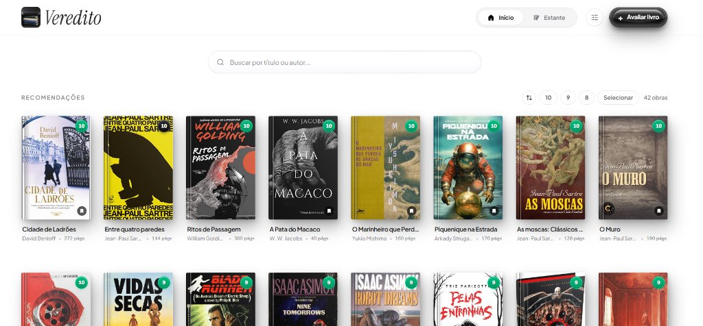
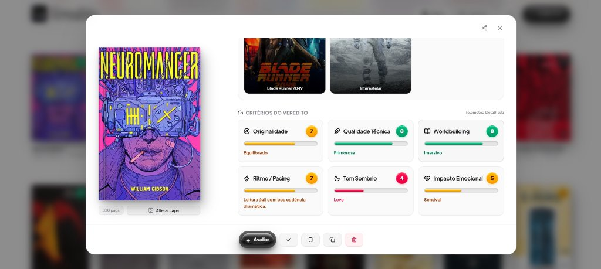
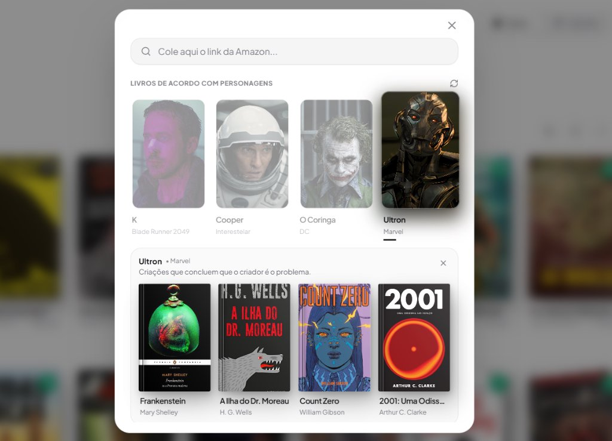
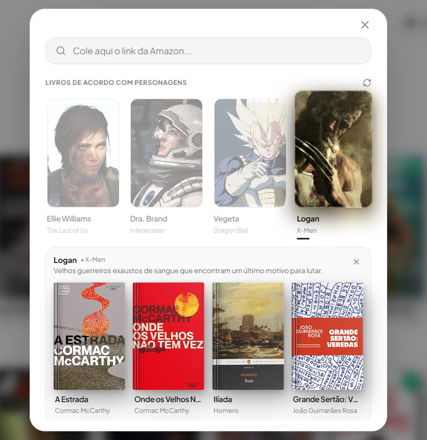
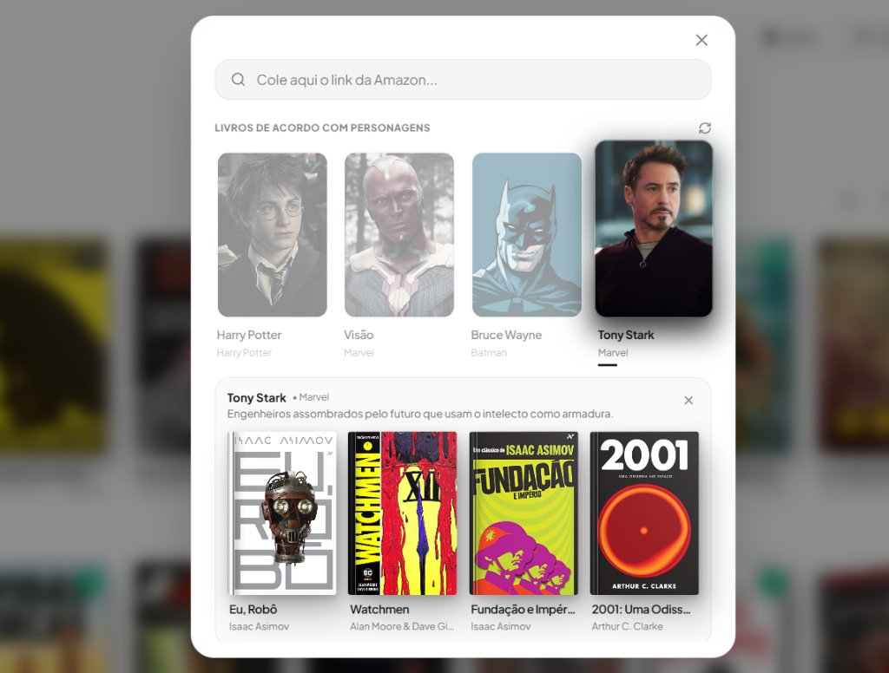
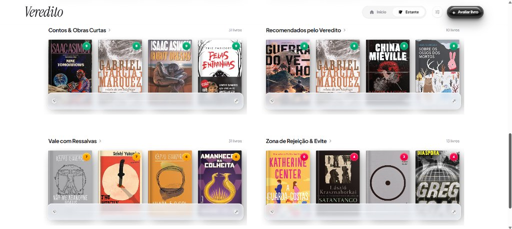

  

  Avaliador e curador pessoal de livros que separa a qualidade de escrita de uma obra do quanto ela realmente combina com o seu gosto.

---

## O Produto

Sinopses de editora parecem propaganda, notas médias da Amazon misturam leitores com gostos opostos e resenhas longas costumam entregar *spoilers*. O **Veredito** foi criado para responder em segundos se um livro vale o seu tempo antes de você comprar ou começar a ler.

### Ficha direta e calibrada para o seu perfil

- **Nota Técnica vs. Nota de Encaixe:** separa se o livro é bem escrito de se ele serve para você. Um clássico pode ter técnica `9` e encaixe `4` para o seu gosto — o app dá o veredito direto (**Leia**, **Vale com Ressalvas** ou **Evite**) sem revelar a trama.
- **6 Critérios + Filmes no mesmo clima:** avalia *Originalidade*, *Qualidade Técnica*, *Worldbuilding*, *Ritmo*, *Tom Sombrio* e *Impacto Emocional*, além de indicar filmes com a mesma atmosfera para situar o tom da obra.
- **Aprende com o que você lê:** ao marcar um livro como lido e dar sua nota, o sistema compara a sua avaliação com a nota que ele havia previsto e ajusta o peso das próximas análises.

---

### Recomendações por Personagem

Quando você não sabe qual livro buscar, basta escolher um personagem da ficção para receber 4 obras que batem com a psicologia e o arco dramático dele:

  
  
  

---

### Estante Organizada Automaticamente

Tudo o que é avaliado ou salvo vai direto para prateleiras separadas por perfil de recomendação, formato e notas, permitindo filtrar, salvar ou excluir vários livros de uma vez.

---

## Engenharia & Arquitetura

**Stack:** `React 19` · `TypeScript` · `Vite` · `Tailwind CSS` · `Motion` · `Supabase` · `Google Gemini API`

| Frente | Como foi resolvido |
| :--- | :--- |
| **Busca de edições brasileiras** `evaluator.ts` · `amazonRecognizer.ts` | A Open Library falha em edições nacionais e a Google Books bloqueia chamadas sem OAuth (`429`). O app extrai `ASIN`/`ISBN` direto de links da Amazon (puxando a capa oficial da CDN deles), consulta a Câmara Brasileira do Livro (BrasilAPI) e mantém um catálogo em memória para resposta imediata. |
| **Concorrência contra lentidão** `geminiRace.ts` | Para evitar espera quando a API oscila ou retorna `503`, o `raceGemini` dispara o modelo principal e aciona modelos reserva em paralelo se passar do tempo limite, abortando as conexões restantes via `AbortController` assim que o primeiro JSON válido chega. |
| **Retroalimentação de notas** `ratings.ts` | As notas dadas pelo usuário nos livros lidos geram um histórico de divergência (`nota prevista → nota do leitor`), injetado nas análises seguintes para corrigir o gosto sem necessidade de *fine-tuning*. |
| **UI otimista e validação de capas** `supabase.ts` · `BookCover.tsx` | Leitura em memória (`O(1)`) com sincronização em background no Supabase para navegação sem telas de carregamento. O componente de capa também detecta e descarta imagens `1x1` inválidas que CDNs antigas retornam como `HTTP 200`. |
